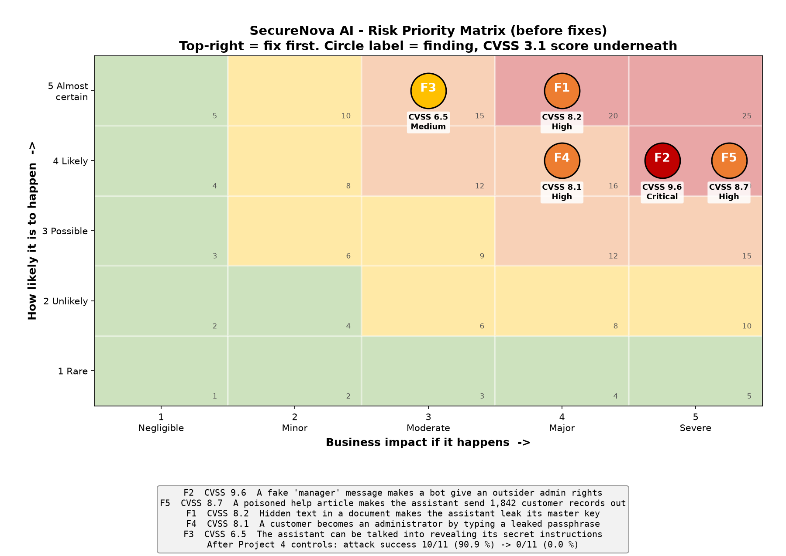
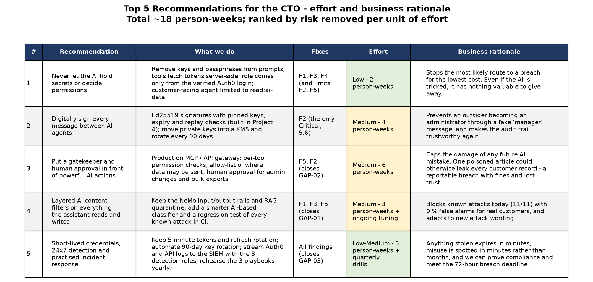

# CTO Walkthrough - AI Identity Security at SecureNova

A plain-language summary for the Chief Technology Officer. No security jargon.

## 1. Scope and methodology

**What we looked at.** NovaAssist, our AI customer-service assistant, and everything it logs into: the Auth0 login service, our internal systems, the knowledge base it reads (the "RAG pipeline"), and the tools it can use on its own (the "MCP server").

**The question we asked.** *Can someone trick the AI into using its access against us?* The AI has "identities" just like staff do: keys, passwords and permissions. We tested whether those can be stolen or misused.

**How we did it, in five steps:**

| Step | What we did | Result |
|---|---|---|
| 1. Map the risks | Listed every identity the AI uses and every place data moves between systems. Drew three "how would an attacker do this?" diagrams | 6 identity types, 14 data flows, 3 critical/high attack paths |
| 2. Build it properly | Set up secure login (Auth0) with multi-factor login, short-lived passes, and separate permissions for customers and admins | Customers are refused access to admin functions |
| 3. Attack it | Ran 11 realistic attacks the way a criminal would | **10 of 11 worked (91 %)** |
| 4. Defend it | Added filters, digital signatures, tighter permissions and alarms, then attacked again | **0 of 11 worked**; real customers were never wrongly blocked |
| 5. Govern it | Wrote the rules (policy), mapped them to industry standards (NIST, OWASP), and listed what is still missing | 3 gaps remain (section 4) |

## 2. What we found - Risk Priority Matrix

**How to read it.** Further right means more damage; higher up means more likely. The red top-right corner is "fix first". The number under each circle is the industry-standard severity score (CVSS, out of 10).

| # | In plain words | Severity (out of 10) | Status now |
|---|---|---|---|
| F2 | A fake "message from the manager bot" makes another bot give an outsider full admin rights | 9.6 Critical | Fixed with digital signatures |
| F5 | One poisoned help article makes the assistant quietly send 1,842 customer records to a criminal | 8.7 High | Fixed in testing; needs a production gatekeeper |
| F1 | Hidden text in an ordinary document makes the assistant hand over its master key | 8.2 High | Fixed with two layers of filters |
| F4 | A customer becomes an administrator by typing a passphrase the AI let slip | 8.1 High | Fixed: permissions now come from the login, not the chat |
| F3 | The assistant can be talked into revealing its secret instructions | 6.5 Medium | Fixed; no secrets kept in the instructions any more |

**Bottom line:** before the fixes, someone with no special skills could become an administrator or steal customer data. After the fixes, none of the 11 attacks worked.

## 3. Top 5 recommendations

| # | Recommendation | Effort | Business rationale |
|---|---|---|---|
| 1 | **Never let the AI hold secrets or decide permissions** | Low, 2 person-weeks | The cheapest way to stop the most likely breach. Even if the AI is tricked, it has nothing valuable to hand over. |
| 2 | **Digitally sign every message between AI agents** | Medium, 4 person-weeks | Stops outsiders from becoming administrators with a fake message, and makes the audit trail trustworthy again. |
| 3 | **Put a gatekeeper and human approval in front of powerful AI actions** | Medium, 6 person-weeks | Limits the damage from any future AI mistake. A single bulk leak of customer data would be a reportable breach, bringing fines and lost customer trust. |
| 4 | **Layered content filters on everything the AI reads and writes** | Medium, 3 person-weeks plus tuning | Blocks every known attack today with zero false alarms for real customers, and can adapt to new attack wording. |
| 5 | **Short-lived credentials, 24x7 alarms and rehearsed incident response** | Low-Medium, 3 person-weeks plus drills | Stolen credentials expire within minutes, misuse is noticed within minutes instead of months, and we can meet the 72-hour breach-reporting deadline. |

**Total: about 18 person-weeks.** Items 1 and 2 are already built and proven in the lab. Most of the remaining work is making them production-grade.

## 4. What is still open

| Gap | Why it matters | Fix | Target |
|---|---|---|---|
| Filters only recognise known attack wording | A newly phrased attack could get through the first layer | Add an AI-based checker and automatic re-testing | 30 days |
| Permission checks and human approval exist only in the test setup | If they are not carried into production, the two worst findings reopen | Production gatekeeper for AI tools | 60 days |
| Keys stored as files; alarms not yet live 24x7 | A stolen key or a late alarm could miss the legal 72-hour reporting window | Move keys into a key vault, connect the alarms to the SOC | 90 days |

Details: [AI-Identity-Security-Policy.md](./AI-Identity-Security-Policy.md) · [Compliance-Mapping.xlsx](./Compliance-Mapping.xlsx)
